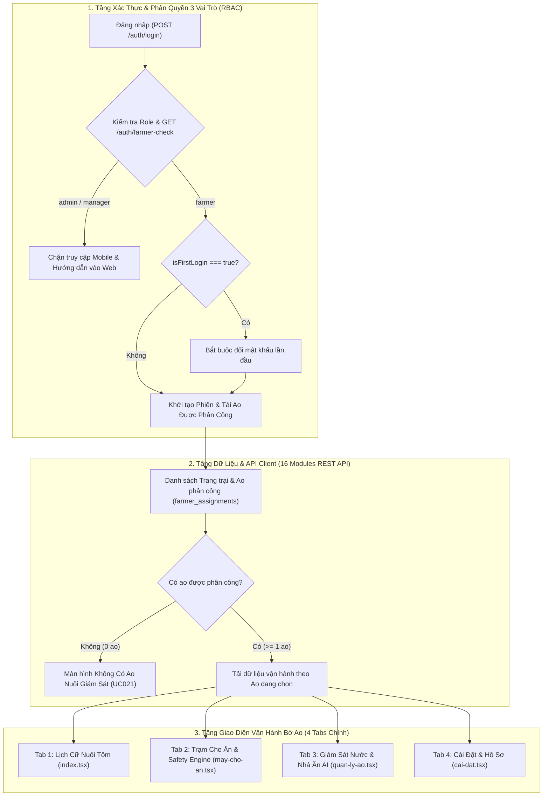

# BÁO CÁO TỔNG HỢP CHI TIẾT CÁC TASK & CHỨC NĂNG ĐÃ THỰC HIỆN
## Dự Án: Ứng Dụng Di Động Vận Hành Bờ Ao Thông Minh — ShrimpMate Mobile

- **Nền tảng công nghệ**: React Native `0.88.1`, Expo SDK `58.0.23`, Expo Router `~58.0.30`, TypeScript `~6.0.2`, NativeWind `^4.2.1`
- **Nhánh làm việc hiện tại**: `standardize-ui-data`
- **Tài liệu đặc tả tuân thủ**:
  1. *Kiến trúc phân quyền 3 vai trò (3-Role RBAC & Boundary Specification)*
  2. *Đặc tả 16 Modules REST API — ShrimpMate Backend API*

---

## 1. Tổng Quan Kiến Trúc & Luồng Nghiệp Vụ Hệ Thống

---

## 2. Danh Mục Tổng Hợp Các Nhóm Task Đã Thực Hiện

| STT | Mã Nhóm Task | Tên Hạng Mục / Chức Năng | Trạng Thái | Commit Tiêu Biểu |
| :--: | :--- | :--- | :--: | :--- |
| 1 | **TASK-01** | Xây dựng hạ tầng API Client, Silent Refresh Token (Mutex) & 16 Modules Endpoints | Hoàn tất | `0ef923e`, `f942f0e`, `68161dc` |
| 2 | **TASK-02** | Kiến trúc Phân quyền 3 Vai trò (3-Role RBAC), Chặn kép Admin/Manager & First-Login Guard | Hoàn tất | `a359ecc`, `4aa8089` |
| 3 | **TASK-03** | Quản lý Phân công Bờ ao (`farmer_assignments`), Đồng bộ Đa Ao & Chế độ Ngoại tuyến (Offline Cache) | Hoàn tất | `8dd42a1`, `abb9d1d`, `4aa8089` |
| 4 | **TASK-04** | Tab Lịch Cữ (`index.tsx`): Khẩu phần ngày, Khuyến nghị AI, Nhật ký cữ ăn & Cho ăn nhanh | Hoàn tất | `a359ecc`, `4aa8089`, `1ba43c0` |
| 5 | **TASK-05** | Tab Trạm Ăn (`may-cho-an.tsx`): Safety Rule Engine, Điều khiển Máy rải cám & Emergency Stop 1 chạm | Hoàn tất | `a359ecc`, `346eaf2`, `1ba43c0` |
| 6 | **TASK-06** | Tab Giám Sát (`quan-ly-ao.tsx`): 6 Chỉ số môi trường nước (Telemetry), Camera AI & Điểm bắt mồi FIS | Hoàn tất | `a359ecc`, `dd1d7bf`, `2c9e3af` |
| 7 | **TASK-07** | Tab Cài Đặt (`cai-dat.tsx`) & Thanh Header chung (`app-header.tsx`): Cảnh báo, Hồ sơ, Đổi mật khẩu | Hoàn tất | `0ef923e`, `4aa8089`, `346eaf2` |
| 8 | **TASK-08** | Nâng cấp nền tảng lên Expo SDK 58 (`React 19.3.0`, `React Native 0.88.1`) tương thích Expo Go | Hoàn tất | `cf04974` |
| 9 | **TASK-09** | Chuẩn hóa dữ liệu thực tế (xóa Mock Data), xử lý lỗi giao diện & chuẩn hóa kiểu số PostgreSQL (`decimal`) | Hoàn tất | `dd1d7bf`, `346eaf2`, `2c9e3af`, `1ba43c0` |

---

## 3. Chi Tiết Các Chức Năng & Module Đã Triển Khai

### 3.1. Hạ Tầng Kết Nối API & Quản Lý Phiên (`src/api/`)
- **HTTP Client trung tâm** ([`src/api/client.ts`](file:///d:/KLTN/ShrimpMate_Mobile/src/api/client.ts)):
  - Tự động đính kèm `Authorization: Bearer <accessToken>` từ bộ nhớ vào mọi request.
  - **Cơ chế Silent Refresh Token với khóa Mutex (`refreshPromise`)**: Khi gặp mã lỗi HTTP `401 Unauthorized`, hệ thống tự động gọi `POST /auth/refresh-token` một lần duy nhất cho tất cả các request đồng thời và thực thi lại các request bị gián đoạn.
  - **Bóc tách Response chuẩn NestJS**: Tự động đọc cấu trúc `{ success, statusCode, data, message }` từ Backend.
  - **Thông báo lỗi thân thiện**: Rút gọn thông báo lỗi mất kết nối máy chủ thành *"Không thể kết nối đến máy chủ. Vui lòng thử lại sau."* (ẩn các chi tiết kỹ thuật và đường dẫn URL nội bộ).
- **Ánh xạ đầy đủ 16 Modules REST API** ([`src/api/endpoints.ts`](file:///d:/KLTN/ShrimpMate_Mobile/src/api/endpoints.ts)):
  - Bao phủ toàn bộ các nhóm endpoint: `AUTH`, `USERS`, `FARMS`, `PONDS`, `CROP_SEASONS`, `DEVICES`, `TELEMETRY`, `CAMERA`, `AI`, `FEEDING_SCHEDULES`, `FEEDING_RECORDS`, `SAFETY_RULES`, `SAFETY_LOGS`, `ALERTS`, `ALERT_RULES`, `REPORTS`, `FARMERS`.
- **Các lớp Service chuyên biệt**:
  - [`auth.service.ts`](file:///d:/KLTN/ShrimpMate_Mobile/src/api/services/auth.service.ts): Đăng nhập, đăng xuất, làm mới token, kiểm tra quyền Farmer (`GET /auth/farmer-check`), hồ sơ cá nhân (`GET/PATCH /users/me`), đổi mật khẩu, quên mật khẩu OTP 3 bước.
  - [`farm-pond.service.ts`](file:///d:/KLTN/ShrimpMate_Mobile/src/api/services/farm-pond.service.ts): Truy vấn trang trại, danh sách ao nuôi, thiết bị IoT, mùa vụ thả nuôi (`crop-seasons`).
  - [`pond.service.ts`](file:///d:/KLTN/ShrimpMate_Mobile/src/api/services/pond.service.ts): Truy vấn dữ liệu cảm biến (`telemetry/latest`), kết quả phân tích nhá ăn (`latest-fis`), chụp/phân tích ảnh sàng ăn (`camera/analyze`), khuyến nghị AI (`ai/recommendations/latest`), lịch cho ăn, nhật ký cữ ăn, đánh giá khóa an toàn sinh học (`safety-rules/evaluate`) và dừng khẩn cấp thiết bị (`emergency-stop`).
  - [`alert.service.ts`](file:///d:/KLTN/ShrimpMate_Mobile/src/api/services/alert.service.ts): Lấy danh sách cảnh báo, số lượng cảnh báo chưa đọc (`unread-count`), xác nhận (`acknowledge`) và xử lý (`resolve`) cảnh báo.
  - [`farmer.service.ts`](file:///d:/KLTN/ShrimpMate_Mobile/src/api/services/farmer.service.ts): Quản lý danh sách nhân sự bờ ao và phân công ao nuôi (`farmer_assignments`).

---

### 3.2. Phân Quyền 3 Vai Trò (3-Role RBAC) & Bảo Mật Tài Khoản (`src/context/auth-context.tsx`, `src/app/(auth)/`)
- **Kiểm soát chặt chẽ 3 vai trò (`admin`, `manager`, `farmer`)** trong [`auth-context.tsx`](file:///d:/KLTN/ShrimpMate_Mobile/src/context/auth-context.tsx) và [`_layout.tsx`](file:///d:/KLTN/ShrimpMate_Mobile/src/app/_layout.tsx):
  - **Chặn kép `admin` và `manager`**: Khi đăng nhập hoặc khởi tạo phiên (`initAuth`), nếu phát hiện `user.role === 'admin'` hoặc `'manager'`, hoặc API `GET /auth/farmer-check` trả về `403 Forbidden`, ứng dụng lập tức hủy phiên trên thiết bị di động và hiển thị hộp thoại hướng dẫn truy cập đúng nền tảng Web quản trị.
  - **Chỉ cho phép `farmer` vận hành trên Mobile**: Đảm bảo đúng phạm vi trách nhiệm của người nuôi trực tiếp tại bờ ao.
- **Màn hình Đăng nhập & Quên mật khẩu OTP 2 bước** ([`login.tsx`](file:///d:/KLTN/ShrimpMate_Mobile/src/app/(auth)/login.tsx)):
  - Hỗ trợ đăng nhập bằng Số điện thoại hoặc Email.
  - Tích hợp quy trình khôi phục mật khẩu chuẩn 3 API: Gửi mã OTP 6 số (`POST /auth/forgot-password`) -> Xác thực mã OTP (`POST /auth/verify-reset-otp`) -> Đặt lại mật khẩu mới (`POST /auth/reset-password`).
- **Màn hình Hướng dẫn cấp phát tài khoản bờ ao** ([`register.tsx`](file:///d:/KLTN/ShrimpMate_Mobile/src/app/(auth)/register.tsx)):
  - Thay thế form tự đăng ký tự do bằng màn hình hướng dẫn **"3 Bước Nhận Tài Khoản Vận Hành"** từ Quản lý trang trại theo đúng quy định phân quyền.
  - Tinh gọn giao diện: Đã loại bỏ các thẻ hướng dẫn dành cho Quản lý, thẻ/nút gọi tổng đài `1800 6868` và xử lý triệt để lỗi cuộn tràn thanh trạng thái (Status Bar) trên iOS.
- **Guard Bắt buộc đổi mật khẩu lần đầu** ([`first-change-password.tsx`](file:///d:/KLTN/ShrimpMate_Mobile/src/app/(auth)/first-change-password.tsx)):
  - Khi tài khoản Farmer mới được cấp đăng nhập lần đầu (`user.isFirstLogin === true`), Navigation Guard tự động giữ người dùng tại màn hình thiết lập mật khẩu cá nhân mới trước khi cho phép vào các tab vận hành ao.

---

### 3.3. Quản Lý Ngữ Cảnh Ao Nuôi & Phân Vùng Dữ Liệu (`src/context/farm-context.tsx`)
- **Cô lập dữ liệu theo phân công (`Assignment-based Isolation`)**:
  - Tự động tải danh sách trang trại và các ao nuôi mà người nuôi được phân công.
  - Khi tài khoản chưa được gán ao nào (`ponds.length === 0`), cả 3 tab vận hành tự động hiển thị thành phần [`NoAssignedPondState`](file:///d:/KLTN/ShrimpMate_Mobile/src/components/common/no-assigned-pond.tsx) hướng dẫn liên hệ Quản lý phân công kèm nút **"Kiểm tra lại phân công ao"**.
- **Lưu trữ đệm Ngoại tuyến (Offline Cache)** ([`storage.ts`](file:///d:/KLTN/ShrimpMate_Mobile/src/utils/storage.ts)):
  - Lưu trữ trạng thái trang trại, ao đang chọn và dữ liệu vận hành gần nhất vào `AsyncStorage` để hỗ trợ tra cứu khi tín hiệu mạng bờ ao chập chờn, đồng thời hiển thị nhãn `Chế độ Bờ Ao Ngoại Tuyến` khi mất kết nối.
- **Loại bỏ hoàn toàn dữ liệu giả (Mock Fallback)**:
  - Xóa bỏ toàn bộ dữ liệu mẫu cố định trước đây. Khi ao nuôi trên hệ thống chưa có dữ liệu đo hoặc lịch cho ăn, ứng dụng hiển thị trạng thái trống (`--`, `"Chưa có dữ liệu"`) trung thực với cơ sở dữ liệu Backend.

---

### 3.4. Chức Năng Trên 4 Tab Vận Hành Chính (`src/app/(tabs)/`)

#### A. Thanh Header Vận Hành Chung ([`app-header.tsx`](file:///d:/KLTN/ShrimpMate_Mobile/src/components/common/app-header.tsx))
- Hiển thị thương hiệu **ShrimpMate** và tên trang trại ngắn gọn (ví dụ: `Trang trại Sóng Xanh`).
- **Bộ chọn chuyển đổi nhanh Ao nuôi (`Pond Selector Modal`)**: Hiển thị tên ao rút gọn (`Ao 1`, `Ao 2`...) giúp không chiếm diện tích và không đẩy mất nút Chuông cảnh báo hay nút Hồ sơ cá nhân.
- **Trung tâm Cảnh báo khẩn cấp (`Alert Modal`)**: Hiển thị badge số lượng cảnh báo chưa đọc, cho phép lọc theo mức độ (`critical`, `warning`) và xác nhận đã xử lý ngay tại bờ ao.
- **Hộp thoại Hồ sơ nhanh**: Xem thông tin người nuôi, kiểm tra kết nối máy chủ và đăng xuất an toàn.

#### B. Tab 1: Lịch Cữ Nuôi Tôm ([`index.tsx`](file:///d:/KLTN/ShrimpMate_Mobile/src/app/(tabs)/index.tsx))
- **Thẻ Tóm tắt Ao nuôi**: Hiển thị tên ao, diện tích ($\text{m}^2$), chỉ số Oxy hòa tan (`DO`) và nhiệt độ nước hiện tại.
- **Thẻ Khẩu Phần Hôm Nay**:
  - Tổng hợp **Tổng định mức (kg)**, **Đã rải (kg)**, **Còn lại (kg)**, phần trăm tiến độ hoàn thành khẩu phần ngày, điểm bắt mồi FIS và sinh khối ước tính.
- **Khối Khuyến Nghị Khẩu Phần Từ AI (`AI Recommendation Card`)**:
  - Hiển thị lượng cám AI đề xuất cho cữ kế tiếp kèm lý do phân tích sinh học, cho phép người nuôi bấm **"Áp dụng mức cám AI"** hoặc **"Giữ nguyên lịch"**.
- **Danh sách Lịch cho ăn & Nhật ký cữ ăn + Cho Ăn Nhanh (`Quick Feed`)**:
  - Cho phép tạo cữ ăn mới, chỉnh sửa khung giờ / định mức cám, xóa cữ ăn, hoặc phát lệnh **Cho Ăn Nhanh** có kiểm tra khóa an toàn sinh học trước khi rải.

#### C. Tab 2: Trạm Ăn & Safety Rule Engine ([`may-cho-an.tsx`](file:///d:/KLTN/ShrimpMate_Mobile/src/app/(tabs)/may-cho-an.tsx))
- **Banner Trạng thái Safety Rule Engine**:
  - Tự động đánh giá ngưỡng an toàn sinh học từ cảm biến (`DO`, `pH`) và hiển thị 4 trạng thái rõ ràng: **Đạt chuẩn cho ăn** (Xanh), **Điều chỉnh giảm cám** (Vàng), **Khóa an toàn sinh học** (Đỏ - khi $\text{DO} < 3.5\text{ mg/L}$), hoặc **Chưa có dữ liệu đo** (Xám).
- **Trạng thái Máy Cho Ăn Tự Động**:
  - Theo dõi kết nối thiết bị (`online`/`offline`), tiến độ rải cám thời gian thực, lượng cám còn lại trong bồn chứa, tốc độ rải ($\text{kg/phút}$) và bán kính phun ($\text{m}$).
- **Nút Dừng Khẩn Cấp 1 Chạm (`EMERGENCY STOP`)**:
  - Gọi trực tiếp API `POST /devices/:id/emergency-stop` để ngắt motor rải cám ngay lập tức khi phát hiện sự cố tại bờ ao.
- **Bảng Điều Khiển Rải Cám Thủ Công**:
  - Cho phép điều chỉnh lượng cám rải bổ sung và bắt buộc đi qua bước kiểm tra `POST /ponds/:pondId/safety-rules/evaluate` trước khi kích hoạt thiết bị.

#### D. Tab 3: Giám Sát Môi Trường Nước & Nhá Ăn AI ([`quan-ly-ao.tsx`](file:///d:/KLTN/ShrimpMate_Mobile/src/app/(tabs)/quan-ly-ao.tsx))
- **Trực quan hóa Camera Sàng Ăn (Nhá Tôm) & Kiểm tra độ tươi ảnh (`Stale Check`)**:
  - Hiển thị hình ảnh sàng ăn mới nhất từ `GET /camera/ponds/:pondId/latest-fis` hoặc khung chờ Camera khi chưa có dữ liệu.
  - Tự động cảnh báo nhãn màu vàng **"Mất tín hiệu Camera (> 120s)"** khi `isStale === true` hoặc `ageSeconds > 120`.
  - Hỗ trợ nút **"Chụp ảnh / Phân tích nhá mới bằng AI"** (`POST /camera/analyze`) để cập nhật điểm FIS tức thì.
- **Thang Đánh Giá Sức Ăn Trên Nhá (`FIS - Feeding Intensity Score`, Mức 0 – 3)**:
  - Thể hiện trực quan 4 mức độ tiêu thụ cám của tôm trên nhá: **Mức 0 (Không ăn - Dư cám nhiều)**, **Mức 1 (Ăn yếu - Sót cám nhá)**, **Mức 2 (Bình thường - Tiêu thụ ổn)**, **Mức 3 (Ăn mạnh - Sạch nhá)**.
- **6 Chỉ Số Môi Trường Nước (`Telemetry Gauges`)**:
  - Hiển thị đầy đủ 6 thông số từ `GET /ponds/:pondId/telemetry/latest`: **1. Oxy Hòa Tan (DO)**, **2. Độ pH Nước**, **3. Nhiệt Độ Nước**, **4. Độ Mặn (Salinity)**, **5. Khí Độc $\text{NH}_3$**, **6. Độ Đục (Turbidity)**.
  - Tự động phân loại màu sắc cảnh báo theo quy chuẩn sinh học: **An toàn** (Xanh), **Cần chú ý** (Vàng), **Nguy hiểm** (Đỏ), hoặc **Chưa có dữ liệu** (Xám khi giá trị là `--`).

#### E. Tab 4: Cài Đặt & Quản Lý Hồ Sơ ([`cai-dat.tsx`](file:///d:/KLTN/ShrimpMate_Mobile/src/app/(tabs)/cai-dat.tsx))
- Cập nhật thông tin cá nhân (Họ tên, Số điện thoại) qua `PATCH /users/me`.
- Đổi mật khẩu bảo mật (`POST /auth/change-password`).
- Quản lý danh sách thiết bị bờ ao (`IoT Feeder`, `Sensor Node`, `Camera AI`), làm mới kết nối dữ liệu và đăng xuất tài khoản.

---

## 4. Tổng Hợp Các Lỗi Kỹ Thuật & Giao Diện Đã Xử Lý Triệt Để

| STT | Vấn Đề / Lỗi Phát Sinh | Nguyên Nhân Gốc Rễ | Giải Pháp Đã Thực Hiện | File Chỉnh Sửa |
| :--: | :--- | :--- | :--- | :--- |
| 1 | **Lỗi không tương thích Expo Go trên iOS (SDK 58 vs SDK 57)** | Ứng dụng Expo Go trên iOS đã tự động cập nhật lên SDK 58 trong khi project đang ở SDK 57. | Nâng cấp toàn bộ project lên `expo@~58.0.23`, `react@19.3.0`, `react-native@0.88.1`, `expo-router@~58.0.30` và cập nhật `AGENTS.md`. | [`package.json`](file:///d:/KLTN/ShrimpMate_Mobile/package.json), [`AGENTS.md`](file:///d:/KLTN/ShrimpMate_Mobile/AGENTS.md) |
| 2 | **Mất nút Chuông cảnh báo và Avatar trên thanh Header cam** | Nhãn tên trang trại kèm tên tab và tên ao dài đẩy cụm nút bên phải tràn ra ngoài màn hình. | Thêm `flex: 1, marginRight: 8` cho khối trái, `flexShrink: 0` cho khối phải; rút gọn nhãn thành `Trang trại Sóng Xanh` và `Ao 1`. | [`app-header.tsx`](file:///d:/KLTN/ShrimpMate_Mobile/src/components/common/app-header.tsx) |
| 3 | **Lỗi `Uncaught (in promise) Error: Không thể đánh giá an toàn sinh học...`** | Khi ao chưa có dữ liệu đo (`latestTelemetry === null`) và gọi `evaluateSafetyBeforeFeed`, hàm fallback ném `throw new Error(...)` không được bắt. | Trả về kết quả an toàn `{ decision: 'blocked', allowedAmountKg: 0, ... }` khi thiếu dữ liệu đo thay vì ném lỗi crash màn hình. | [`pond.service.ts`](file:///d:/KLTN/ShrimpMate_Mobile/src/api/services/pond.service.ts), [`index.tsx`](file:///d:/KLTN/ShrimpMate_Mobile/src/app/(tabs)/index.tsx), [`may-cho-an.tsx`](file:///d:/KLTN/ShrimpMate_Mobile/src/app/(tabs)/may-cho-an.tsx) |
| 4 | **Treo màn hình kèm vòng xoay đỏ khi chuyển qua lại giữa các Tab trên iOS** | Cả 3 tab đều gắn `RefreshControl` trực tiếp vào biến toàn cục `isRefreshingPondData`, khiến tab ẩn trên iOS bị kẹt trạng thái kéo làm mới. | Tách state `isManualRefreshing` cục bộ riêng cho từng màn hình, chỉ bật khi người dùng thực sự vuốt kéo xuống (`onRefresh`). | [`index.tsx`](file:///d:/KLTN/ShrimpMate_Mobile/src/app/(tabs)/index.tsx), [`quan-ly-ao.tsx`](file:///d:/KLTN/ShrimpMate_Mobile/src/app/(tabs)/quan-ly-ao.tsx), [`may-cho-an.tsx`](file:///d:/KLTN/ShrimpMate_Mobile/src/app/(tabs)/may-cho-an.tsx) |
| 5 | **Lỗi `[TypeError: undefined is not a function]` tại `totalTargetKg.toFixed(1)`** | Các cột `decimal(10,2)` từ PostgreSQL trả về chuỗi (ví dụ `"15.00"`), khiến `.reduce()` nối chuỗi thành `"015.00"` và làm sập `.toFixed(1)`. | Ép kiểu `Number(...)` cho toàn bộ các trường số học ngay tại tầng API Service, Context và tại các biểu thức `.reduce()` / `.toFixed()`. | [`pond.service.ts`](file:///d:/KLTN/ShrimpMate_Mobile/src/api/services/pond.service.ts), [`farm-pond.service.ts`](file:///d:/KLTN/ShrimpMate_Mobile/src/api/services/farm-pond.service.ts), [`farm-context.tsx`](file:///d:/KLTN/ShrimpMate_Mobile/src/context/farm-context.tsx), [`index.tsx`](file:///d:/KLTN/ShrimpMate_Mobile/src/app/(tabs)/index.tsx), [`quan-ly-ao.tsx`](file:///d:/KLTN/ShrimpMate_Mobile/src/app/(tabs)/quan-ly-ao.tsx), [`may-cho-an.tsx`](file:///d:/KLTN/ShrimpMate_Mobile/src/app/(tabs)/may-cho-an.tsx) |
| 6 | **Hiển thị sai nhãn `"AN TOÀN"` / `"Đạt chuẩn sinh học"` khi chưa có dữ liệu đo (`--`)** | Điều kiện kiểm tra dữ liệu rỗng chưa đồng nhất ở ô DO và thanh trạng thái đầu trang Giám sát. | Kiểm tra chặt chẽ `hasTelemetry`; khi chưa có dữ liệu đo thì đồng bộ cả 6 ô chỉ số và banner sang màu xám `"Chưa có dữ liệu"`. | [`quan-ly-ao.tsx`](file:///d:/KLTN/ShrimpMate_Mobile/src/app/(tabs)/quan-ly-ao.tsx) |

---

## 5. Trạng Thái Kiểm Thử & Sẵn Sàng Bàn Giao
- **Kiểm tra kiểu tĩnh TypeScript (`npx tsc --noEmit`)**: Đạt **0 lỗi** trên toàn bộ mã nguồn.
- **Kiểm tra đồng bộ phụ thuộc (`npx expo install --check`)**: Tương thích 100% với **Expo SDK 58**.
- **Trạng thái Git**: Toàn bộ mã nguồn đã được commit sạch sẽ trên nhánh `standardize-ui-data`.
